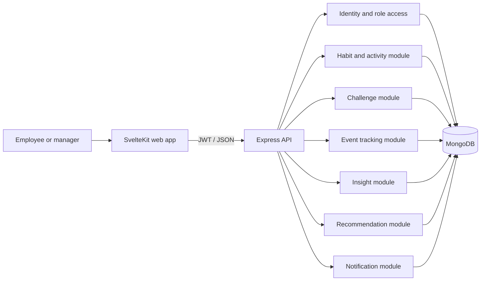

# TeamPulse

TeamPulse is a privacy-first wellness and consistency platform for employees and teams. Employees can record personal activities, build streaks, join team challenges, and view private analytics. Managers see aggregated team progress only. A recommendation service suggests practical times for habits based on each employee's own completion history.

## Technology

- **Frontend:** SvelteKit, Svelte 5 runes, Vite, static adapter
- **Backend:** Node.js 20, Express, Mongoose
- **Database:** MongoDB 7
- **Local environment:** Docker Compose
- **API specification:** OpenAPI 3.0 (`docs/openapi.yaml`)

## Architecture overview

The SvelteKit application uses file-based routes and Svelte 5 runes, and talks to the Express API over JSON. The API is organized into identity, habit, challenge, event tracking, insight, notification, and recommendation modules. MongoDB stores accounts, activities, challenges, events, memberships, and notifications. Employees can manage their own activities and challenge membership. Managers can manage team challenges and account roles, while seeing only aggregated participation analytics.

The AWS deployment is managed in the AWS account and documented in [docs/aws-deployment.md](docs/aws-deployment.md). The app can use S3/CloudFront for the static frontend and an AWS-hosted Express API. EventBridge/Lambda, RDS, and DynamoDB integrations remain future extensions unless enabled and verified in that environment.



See [Network architecture](docs/network-architecture.md) and its [editable draw.io diagram](docs/network-architecture.drawio), [AWS deployment guide](docs/aws-deployment.md), [API documentation](docs/openapi.yaml), [setup guide](docs/setup.md), and [user walkthrough](docs/walkthrough.md).

## Quick start

```bash
docker compose up --build
```

Open http://localhost:5173. The API is available at http://localhost:4000/api and Swagger UI at http://localhost:4000/api-docs. The seeded demo accounts are `employee@teampulse.local` / `PulseDemo2026!` and `manager@teampulse.local` / `PulseDemo2026!`. Change these credentials and `JWT_SECRET` before any shared deployment.

## Repository map

```text
client/       SvelteKit application and static build
server/       Express API, domain modules, seed script
docs/         Setup, walkthrough, network design, OpenAPI specification
docker-compose.yml
```

## Privacy and access boundaries

- Passwords are hashed with bcrypt; API routes require a signed JWT.
- Employees can read and change their own activities and personal analytics.
- Employees can delete only their own activities; related completion events are removed with them.
- Managers can read team-level aggregates and challenge progress, not personal activity histories or individual wellness details.
- Manager administration is limited to team challenge management and account-role management within the manager's team.
- Recommendation inputs and outputs are scoped to the authenticated employee.
- The demo uses a seeded team and locally configured secrets. Replace the demo secret, enable HTTPS, and use managed secret storage before deployment.

## Project links

- **GitHub repository:** [Soumik-Sarkar/team-pulse](https://github.com/Soumik-Sarkar/team-pulse)
- **AWS demo:** [Open TeamPulse](http://teampulse-frontend-141525352907.s3-website-ap-southeast-2.amazonaws.com/)

The demo currently uses an HTTP S3 website endpoint. Use it for the assignment demonstration only; configure HTTPS before sending real employee or wellness data.
