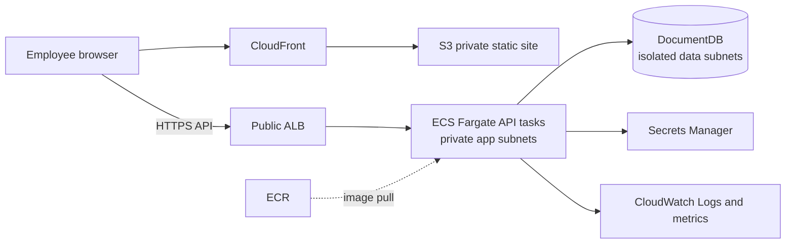

# AWS deployment guide

This guide covers updating the existing AWS deployment for the SvelteKit frontend and expanded Express API, and recording its configuration for submission. The exact AWS topology is account-specific; the repository currently records the API URL in `client/.env.production` and keeps the AWS-facing URL configurable at build time.

## What the current app supports

The code is a **single Express API organized into domain modules**, a static SvelteKit frontend, and MongoDB persistence. It is not yet a set of independently deployable microservices. A practical AWS mapping for this source is:

| Current app part | AWS deployment target |
| --- | --- |
| SvelteKit/Svelte 5 static frontend | S3 private bucket + CloudFront |
| Express API container | ECR image + ECS Fargate service behind an ALB |
| MongoDB data | Amazon DocumentDB (MongoDB-compatible) after connection/TLS configuration and compatibility checks |
| Secrets and runtime configuration | Secrets Manager for `MONGO_URI` and `JWT_SECRET`; task environment for nonsecret values |
| Logs, metrics, alerts | CloudWatch Logs and ECS/ALB metrics |

The API currently writes activity events to MongoDB and calculates its recommendations inside Express. **It does not currently publish to EventBridge, run Lambda consumers, or use RDS/DynamoDB.** Those are future architecture extensions from the case study; don’t present them as deployed/working unless you implement and test those integrations. Amazon DocumentDB is an optional AWS-managed MongoDB-compatible target; it is not Amazon RDS. Keep the Mongo deployment you already configured unless you deliberately plan and test a database migration.

## Update your existing AWS deployment

The checked-in production frontend config currently points to `http://16.178.122.67:4000/api`. The SvelteKit build continues to read `VITE_API_URL`, so the existing setting is preserved. Confirm the address still reaches your running API before building; if AWS assigned a new address or you have an ALB/domain, update `client/.env.production` to that API base URL instead. The case-study requires HTTPS: use an HTTPS ALB/reverse proxy and update the API URL to `https://...` before presenting a public demo, because the app sends bearer tokens and private wellness data.

The SvelteKit static adapter writes the deployable site to `client/dist/` and includes a `200.html` SPA fallback. From PowerShell at the repository root, build it with the configured production endpoint:

```powershell
cd client
npm ci
npm run build
```

Upload the **contents** of `client/dist/` to the same frontend S3 bucket used by your current deployment. Keep Block Public Access enabled when CloudFront uses OAC. In CloudFront's error responses, map both `403` and `404` to `/200.html` and return status `200`; this lets direct navigation and refresh work for `/habits`, `/challenges`, `/analytics`, `/recommendations`, `/team`, `/admin`, and `/profile`. Create an invalidation for `/*` after switching from the old frontend bundle so cached files are replaced.

The Express server now has new endpoints for activity update/delete, challenge membership and management, account role management, profile updates, and notification read state. Deploy the updated `server/` source to the **same backend service** that currently serves the configured API URL. If that instance is managed with Docker Compose, pull the updated source and rebuild/restart the API service using your deployment's existing process; if it uses a service manager, update the code and restart that existing service. Keep its MongoDB URI and JWT secret in its existing protected configuration, and set `CLIENT_ORIGIN` to the exact frontend CloudFront/custom-domain origin. Do not switch to a new database or infrastructure topology as part of the frontend replacement.

After both updates, verify `https://<api-host>/api/health`, Swagger UI, then sign in through the CloudFront site and exercise employee activity delete and manager administration. If the API continues to use the current plain-HTTP address, browsers may block it when the frontend is HTTPS; deploying HTTPS for the API is required for an all-HTTPS demo.

## Request flow



Keep the ALB in public subnets, ECS tasks in private application subnets, and DocumentDB in private data subnets. Allow inbound API traffic to the task security group only from the ALB security group; allow DocumentDB port `27017` only from the API task security group. Fargate tasks in private subnets need outbound access for image pulls, secrets, and logs. Use NAT gateways or the required VPC endpoints; NAT gateways and interface endpoints have ongoing charges.

## Before you start

1. Install Docker Desktop, Git, and the AWS CLI v2. Configure the CLI with an IAM identity that can create the listed resources. Avoid using root credentials for routine work.
2. Choose one AWS Region and use it consistently. For a custom CloudFront certificate, ACM certificates must be requested in `us-east-1`; the ALB certificate must be in the ALB's Region.
3. Confirm billing is enabled and review estimated costs before creating NAT gateways, load balancers, Fargate tasks, DocumentDB, CloudFront, and logging. These resources can continue to incur charges while idle.
4. Make sure the app starts locally with Docker Compose first. The API image used below must be built from the repository root because `server/Dockerfile` copies the OpenAPI file from `docs/`.
5. Choose a DNS name for the API, such as `api.example.com`, and a frontend name, such as `app.example.com`. If you do not own a domain, use the CloudFront distribution hostname for the frontend and test the ALB DNS name directly for the API.

## 1. Create the network

In the VPC console, create a VPC across at least two Availability Zones. Create public subnets for the ALB, private application subnets for ECS, and isolated private subnets for DocumentDB. Add route tables and security groups with the boundaries above. Keep DocumentDB non-public. Add NAT per Availability Zone for straightforward private-subnet egress, or create the VPC endpoints needed by ECR, S3, CloudWatch Logs, and Secrets Manager.

Security group rules:

| Security group | Inbound | Source |
| --- | --- | --- |
| ALB | TCP 443 (and optionally 80 only to redirect to 443) | Internet (`0.0.0.0/0`) |
| ECS API tasks | TCP 4000 | ALB security group only |
| DocumentDB | TCP 27017 | ECS API task security group only |

Do not add public inbound rules to ECS tasks or DocumentDB. Network ACLs can provide additional subnet-level controls; security groups should enforce the primary service-to-service policy.

## 2. Create the Mongo-compatible data store

In Amazon DocumentDB, create a cluster in the same VPC and data subnet group. Turn on encryption at rest, keep public access disabled, and store the database username/password in Secrets Manager. Create a DocumentDB security group that accepts port `27017` only from the ECS API task security group.

DocumentDB requires TLS by default for new clusters. Download the AWS CA bundle during the API image build or package it into the image, then use the DocumentDB-provided application connection string with TLS, `replicaSet=rs0`, and `retryWrites=false`. Store the complete URI as the `MONGO_URI` secret. URL-encode special characters in the username/password. Verify the Node MongoDB driver and the app's Mongoose features against the chosen DocumentDB engine version before relying on it; MongoDB compatibility is not identical across all features. AWS documents the TLS certificate and URI requirements in [DocumentDB connection guidance](https://docs.aws.amazon.com/documentdb/latest/devguide/connect-docdb.html) and [connection endpoints](https://docs.aws.amazon.com/documentdb/latest/devguide/endpoints-connecting.html).

The current `server/Dockerfile` does not package the DocumentDB CA bundle. Add it to the API image and reference its container path in `MONGO_URI` (for example, `tlsCAFile=/etc/ssl/certs/global-bundle.pem`) before creating the production API image. Keep the URI out of source control and task-definition plaintext fields.

## 3. Store application secrets

In Secrets Manager, create secrets for:

- `teampulse/prod/MONGO_URI`: the DocumentDB connection URI.
- `teampulse/prod/JWT_SECRET`: a unique, high-entropy signing secret; do not reuse the local Compose value.

In the ECS task definition, reference each secret through the container's **Secrets** section. Give the **task execution role** permission to read only these secrets and write to the service's CloudWatch log group. Use the **task role** for AWS API access from application code; the current app has no AWS SDK calls, so it needs no extra service permissions yet. Secret updates are injected when new tasks start; force a new ECS deployment after rotating a value. See [ECS secrets injection](https://docs.aws.amazon.com/AmazonECS/latest/developerguide/secrets-envvar-secrets-manager.html) and [ECS IAM role guidance](https://docs.aws.amazon.com/AmazonECS/latest/developerguide/security-iam-roles.html).

## 4. Build and push the API image to ECR

Create a private ECR repository named `teampulse-api`. In PowerShell, from the repository root, fill in your own account ID and region:

```powershell
$Region = "us-east-1"
$AccountId = "123456789012"
$Image = "$AccountId.dkr.ecr.$Region.amazonaws.com/teampulse-api:1.0.0"

aws ecr get-login-password --region $Region | docker login --username AWS --password-stdin "$AccountId.dkr.ecr.$Region.amazonaws.com"
docker build -f server/Dockerfile -t teampulse-api:1.0.0 .
docker tag teampulse-api:1.0.0 $Image
docker push $Image
```

Replace the example account and region. Use immutable version tags for releases instead of repeatedly overwriting `latest`. ECR's [official push guide](https://docs.aws.amazon.com/AmazonECR/latest/userguide/getting-started-cli.html) has the current authentication and push steps.

## 5. Create the ECS API service

1. In ECS, create a cluster using the Fargate/serverless option.
2. Create a task definition for Linux/Fargate. Start with `0.5 vCPU` and `1 GB` memory for a demo, then adjust from observed metrics. Set the task execution role described above.
3. Add one essential container named `teampulse-api`, using the ECR image URI. Map container port `4000` over TCP. Set nonsecret values `PORT=4000` and `CLIENT_ORIGIN=https://<your-frontend-domain>`; reference `MONGO_URI` and `JWT_SECRET` as Secrets Manager secrets. Do not include the Compose command that runs `seed.js`; the seed credentials are for local demo use.
4. Configure the container log driver to send logs to a dedicated CloudWatch log group such as `/ecs/teampulse-api`.
5. In EC2/Load Balancing, create an **Application Load Balancer** in the public subnets and a target group with target type **IP**, protocol HTTP, and port `4000`. Set the health-check path to `/api/health`.
6. Request/validate an ACM certificate for the API hostname, then configure an HTTPS `443` listener forwarding to the API target group. Optionally configure port `80` to redirect to HTTPS.
7. Create an ECS service from the task definition. Select Fargate, the private application subnets, and the ECS task security group; leave **Assign public IP** disabled. Attach the ALB target group and choose the `teampulse-api:4000` container mapping. Start with desired count `2` across Availability Zones for availability (or `1` for a short, cost-conscious demonstration with reduced resilience).
8. Wait until the target group reports healthy tasks, then open `https://<api-hostname>/api/health` and `https://<api-hostname>/api-docs`.

An ALB HTTPS listener uses a certificate whose hostname matches the client hostname. The [ALB setup guide](https://docs.aws.amazon.com/elasticloadbalancing/latest/application/create-application-load-balancer.html) documents listener and certificate configuration; ECS also documents [load-balancer health checks](https://docs.aws.amazon.com/AmazonECS/latest/developerguide/load-balancer-healthcheck.html).

## 6. Add DNS and HTTPS

In Route 53 (or your DNS provider), create an alias/CNAME for `api.example.com` pointing to the ALB DNS name. Check the health endpoint over HTTPS. Set the exact frontend origin in the API's `CLIENT_ORIGIN` and redeploy the service. The API's CORS configuration currently allows one origin, so use the final CloudFront/custom domain and not `*`.

For a custom frontend domain, request/validate an ACM certificate in `us-east-1` for CloudFront, then add the domain and certificate to the distribution. Create the Route 53 alias/CNAME after CloudFront finishes deploying.

## 7. Build and host the frontend with S3 and CloudFront

The SvelteKit app reads `VITE_API_URL` at **build time**. Build it with the deployed API URL, not `localhost`:

```powershell
cd client
$env:VITE_API_URL = "https://api.example.com/api"
npm ci
npm run build
```

This produces `client/dist`. In S3, create a private bucket for the static files. Keep Block Public Access enabled and do not enable public website hosting. Upload the **contents** of `dist` to the bucket. In CloudFront, create a distribution with the S3 bucket as an origin, use Origin Access Control (OAC), and allow CloudFront to read the private bucket. Choose HTTPS redirect for viewers and set `200.html` as the default root object.

Because the app uses SvelteKit client-side routes, configure CloudFront custom error responses so S3 `403` and `404` responses for application routes return `/200.html` with viewer status `200`. Test direct refresh on `/habits`, `/challenges`, `/recommendations`, `/analytics`, `/team`, `/admin`, and `/profile`. CloudFront recommends OAC for private S3 origins; website endpoints cannot use OAC. See [CloudFront OAC setup](https://docs.aws.amazon.com/AmazonCloudFront/latest/DeveloperGuide/private-content-restricting-access-to-s3.html), [S3 origins](https://docs.aws.amazon.com/AmazonCloudFront/latest/DeveloperGuide/DownloadDistS3AndCustomOrigins.html), and [custom error responses](https://docs.aws.amazon.com/AmazonCloudFront/latest/DeveloperGuide/custom-error-pages-procedure.html).

After a new frontend build, upload the new `dist` contents and create a CloudFront invalidation for `/200.html` (and for other changed assets if needed). For a new version, prefer content-hashed assets and short cache lifetime for `200.html`.

## 8. Configure scaling and monitoring

In the ECS service's **Auto Scaling** settings, set a minimum and maximum task count, then add a target-tracking policy on average CPU or memory. A demonstration starting point is min `1`, max `4`, CPU target `60%`; tune after observing traffic. ECS target tracking adjusts service task count using CloudWatch metrics and managed alarms; see [ECS target tracking](https://docs.aws.amazon.com/AmazonECS/latest/developerguide/service-autoscaling-targettracking.html).

In CloudWatch:

- Open the API log group and confirm requests/errors are appearing. Never log passwords, tokens, raw secret values, or private wellness details.
- Add alarms for ECS CPU/memory, running task count below desired, ALB 5xx responses/target response time, and DocumentDB CPU/connections/storage.
- Enable ECS Container Insights if task-level dashboards are needed; it can add cost. See [Container Insights setup](https://docs.aws.amazon.com/AmazonCloudWatch/latest/monitoring/deploy-container-insights-ECS-cluster.html).
- Record the alert thresholds, log retention period, dashboard, and alarm state in your deployment notes.

## 9. Optional case-study event extensions

These services are not wired into the app yet. To add them, first change the application and add integration tests:

1. Publish a minimal activity-completed domain event from the API to EventBridge after the database write succeeds. Include event ID, team ID, and event type; do not include unnecessary personal wellness detail.
2. Create an EventBridge rule matching that event and route it to a Lambda function. Make the Lambda idempotent and add retries/dead-letter handling.
3. Store derived, privacy-reviewed aggregates in DynamoDB. Grant the Lambda role only the required table actions; keep employee-level source data out of manager-facing results.
4. If the architecture specifically requires RDS, identify the relational records and migrate/model them separately. The current app does not use RDS; deploying an empty RDS database does not make this integration complete.
5. Add CloudWatch metrics/alarms for event age, Lambda errors/throttles, retries, and dead-letter queue depth.

Do not include EventBridge/Lambda/RDS/DynamoDB in a “deployed and working” claim until the code path has been implemented and demonstrated.

## 10. Verify and capture the submission screenshots

Use a browser to verify the CloudFront frontend, sign in as the employee demo account only if the demo seed users were safely adapted for deployment, add an activity, mark it done and missed, view personal analytics, accept a recommendation, and sign in as the manager to inspect aggregate team metrics. Do not put the local demo password or a real secret in screenshots. Disable or replace demo accounts before exposing a public deployment.

Capture clear screenshots of:

1. VPC resource map showing public, application, and data subnet tiers across the AZs.
2. ALB listeners/certificate and target group health.
3. ECS cluster/service, running tasks, task definition ports and secret references (hide values).
4. ECR repository and pushed image tag/digest.
5. DocumentDB cluster status, VPC placement, encryption/TLS settings, and security group rule (no password/URI shown).
6. S3 bucket Block Public Access and CloudFront OAC/origin configuration; CloudFront distribution deployed.
7. Secrets Manager secret names/rotation settings with secret values hidden.
8. IAM task execution role and task role policies.
9. CloudWatch log group, dashboard, and alarms.
10. Running application: employee dashboard, activity completion, recommendation acceptance, and manager aggregated view.

Add captions with the AWS Region, resource purpose, and relevant setting. Redact account identifiers if required by your submission rules. Keep screenshots in `docs/aws-screenshots/` or the submission package; do not commit secret-bearing configuration.

## Clean up after the demo

Delete resources when they are no longer needed to stop ongoing charges: CloudFront distribution (wait until disabled/deleted), ALB, ECS service and cluster, NAT gateways, DocumentDB cluster/subnet group, VPC endpoints, ECR images/repository if not needed, S3 artifacts, CloudWatch log groups, and nonrequired secrets. Preserve the screenshots and deployment notes first. Verify the billing dashboard after cleanup.

## Useful official AWS references

- [Amazon ECS Fargate task networking](https://docs.aws.amazon.com/AmazonECS/latest/developerguide/fargate-task-networking.html)
- [ECS and least-privilege IAM roles](https://docs.aws.amazon.com/AmazonECS/latest/developerguide/security-iam-roles.html)
- [Amazon ECR: push a Docker image](https://docs.aws.amazon.com/AmazonECR/latest/userguide/getting-started-cli.html)
- [Amazon DocumentDB: connect to a cluster](https://docs.aws.amazon.com/documentdb/latest/devguide/connect-docdb.html)
- [Amazon CloudFront with private S3 and OAC](https://docs.aws.amazon.com/AmazonCloudFront/latest/DeveloperGuide/private-content-restricting-access-to-s3.html)
