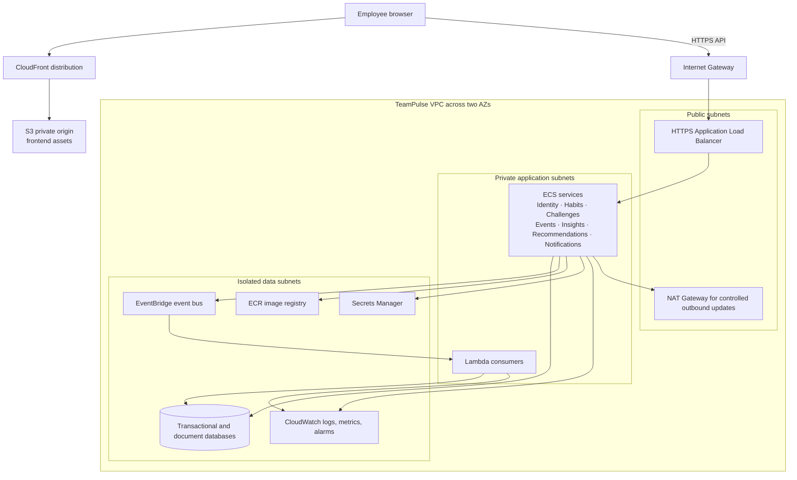

# Network architecture

This diagram describes the logical AWS network tiers for TeamPulse. Compare it with the VPC and service configuration in your deployed AWS account; the local Compose environment does not create or change AWS resources.

## Security boundaries

- Only CloudFront and the ALB accept public client traffic. The ALB terminates TLS and forwards only to ECS targets.
- ECS tasks run in private application subnets. Database endpoints have no public route and accept traffic only from the API task security group on the required database port.
- Security groups are stateful and service-specific. Network ACLs provide subnet-level guardrails; private subnets and route tables constrain paths between tiers.
- Task execution roles pull images from ECR and write logs. Separate task roles grant each service only its required database and event permissions.
- Secrets Manager stores secrets; nonsecret configuration is supplied separately through task environment configuration. TLS protects public and service connections where supported.
- CloudWatch collects service and function logs, request latency, API failures, authentication failures, queue/event processing health, and task restarts; alarms notify operators.

## Trade-offs

Subnet isolation and narrow IAM permissions reduce exposure but add networking and deployment work. Aggregated manager insight endpoints protect employee privacy while limiting manager drill-down. Event-driven processing decouples workloads but requires idempotency, retries, and operational monitoring.
